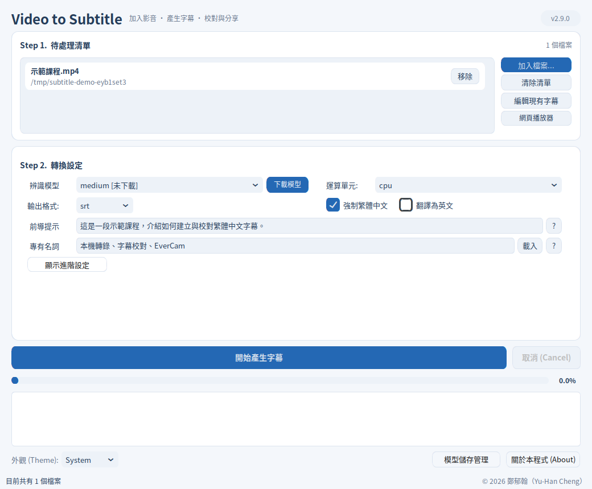
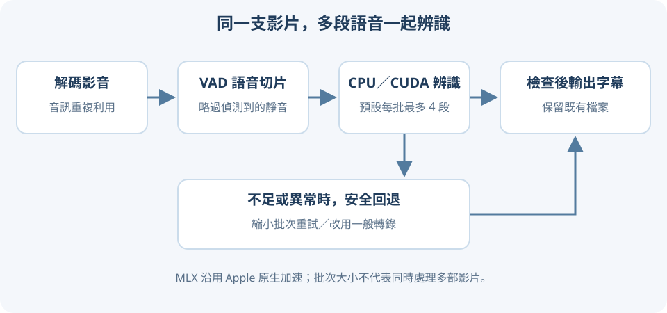
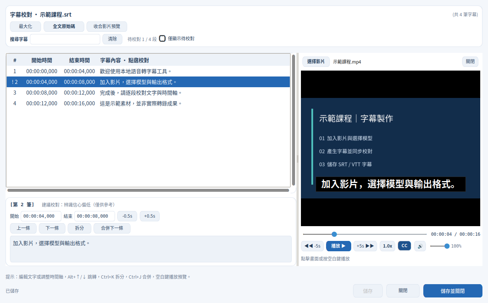
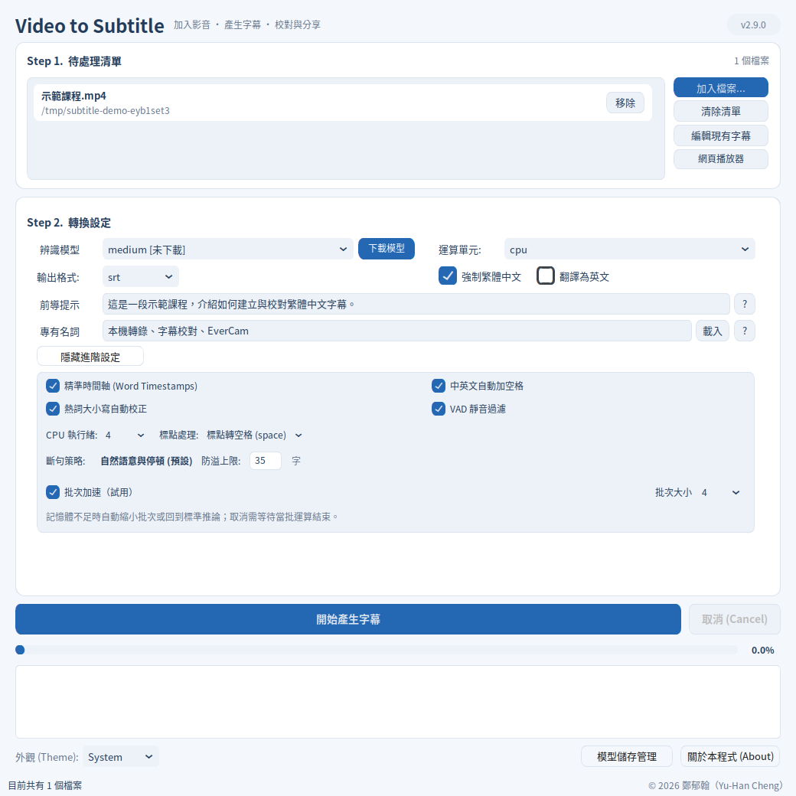
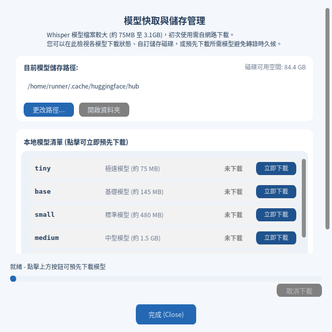

# Video to Subtitle｜本地語音轉字幕工具

把錄好的課程變成可校對的字幕，再整理成可搜尋的網頁教材。以 OpenAI Whisper 的 faster-whisper／mlx-whisper 實作在本機處理影音，適合教師準備數位教材，不必上傳影片到雲端。

🌐 [官方網站](https://kaoshou.github.io/Video-to-Subtitle/) ｜ 📖 [完整使用手冊（繁體中文）](docs/USER_GUIDE.zh-TW.md) ｜ [版本更新內容](https://github.com/kaoshou/Video-to-Subtitle/releases/latest)

## 下載與快速上手

| Windows 免安裝版 | Windows 安裝版 | macOS |
| --- | --- | --- |
| [下載 ZIP](https://github.com/kaoshou/Video-to-Subtitle/releases/latest) | [下載安裝程式](https://github.com/kaoshou/Video-to-Subtitle/releases/latest) | [下載 DMG](https://github.com/kaoshou/Video-to-Subtitle/releases/latest) |

Windows 安裝版將執行環境在安裝時一次展開，通常比每次需要解壓的免安裝版啟動快；兩者的字幕計算方式相同。正式發行版不需另裝 Python 或 FFmpeg；首次使用某個模型仍需下載。

免安裝版下載後先解壓 ZIP，再執行內部的 `VideoToSubtitle.exe`。檔名會標示版本、平台與架構，Windows 安裝程式只提供一份。上方連結皆前往最新正式 Release；[官網下載按鈕](https://kaoshou.github.io/Video-to-Subtitle/)會自動對應最新成品。

**v2.9.1**：一般 MP4 網頁播放器預設顯示右側逐字稿，沿用 EverCam 的搜尋、閱讀設定與鍵盤導覽；待處理清單新增 EverCam／OpenCam 徽章，並修正 MP4 命名資料夾的辨識。[本次更新說明](docs/releases/v2.9.1.md)

1. 加入或拖入影片／音訊，選擇已下載的模型。
2. 選運算單元與 SRT；中文課程可勾選「強制繁體中文」。
3. 按「開始產生字幕」，完成後進入「字幕校對」。
4. 核對字幕後儲存，供教學平台使用，或透過「網頁播放器」製作教材。

本文介面截圖均擷取自 **v2.9.0**，使用 Linux 隔離虛擬顯示環境與示範影音／字幕；不是實際辨識成果。Windows／macOS 的字型與視窗外觀可能略有差異。

## v2.9.0 重點：字幕生成效率

CPU／CUDA 預設啟用「批次加速（試用）」：先以 VAD 找出同一支影片的語音片段，再將多段音訊一起送入辨識，減少逐段處理的開銷。**批次大小預設 4**，可在進階設定改為 2／4／8／16／32，或關閉；不是同時處理多部影片。

- 音訊解碼結果會重複利用，減少重試時的重複處理。
- 記憶體不足時縮小批次，必要時回到一般轉錄；品質或時間軸檢查異常也會回退重做。
- 成功後才發布字幕，保留既有輸出；日誌顯示目前階段、階段耗時及總耗時。
- 速度依設備、模型與音訊而異，較大批次不一定較快。MLX 沿用 Apple 原生加速，不套用 CPU／CUDA 的批次大小。

[批次大小與效能調整](docs/USER_GUIDE.zh-TW.md#批次加速試用) ｜ [效能更新說明](docs/releases/v2.9.0.md)

## 校對更有方向，也保留你的修改

編輯器以 `!` 標記建議檢查的字幕，提供待校對數量、原因提示及篩選：

| 提醒 | 如何運作 |
| --- | --- |
| 辨識信心偏低 | 模型提供的平均對數機率低於 -1.0 時提醒；這不是「正確率百分比」。 |
| 疑似重複內容 | 模型壓縮比大於 2.4，或相鄰字幕文字相同時提醒，協助尋找重複辨識。 |
| 時間軸問題 | 檢查非法時間、結束早於開始，以及相鄰字幕重疊。 |

提醒不會自動刪除或改寫字幕；未被標記也不保證正確。模型信心資訊只保留於本次操作，重新開啟既有 SRT／VTT 時仍能檢查文字重複與時間軸，但不會憑空產生信心分數。

支援同步預覽、搜尋、分割／合併、獨立儲存及 Ctrl+S／macOS ⌘S。未儲存時顯示狀態，關閉前可儲存、捨棄或返回編輯。[校對操作與判定細節](docs/USER_GUIDE.zh-TW.md#待校對提醒)

## 從字幕到數位教材

| 使用情境 | 提供的功能 |
| --- | --- |
| 一般影片／音訊 | SRT、VTT、TXT、TSV、JSON；多檔案依序轉錄；前導提示、熱詞及繁體中文後處理。 |
| 一般 MP4＋字幕 | 自動配對同檔名及語系字幕，另存含影片與 `index.html` 的網頁資料夾；右側直接顯示可搜尋的逐字稿。 |
| EverCam 課程 | 保留原首頁備份，轉換為支援章節、多語字幕與逐字稿搜尋的播放器。 |
| OpenCam 網頁 | 備份後置入字幕資料，保留原播放器、章節及其他語系字幕。 |
| 網頁閱讀與輔助操作 | 逐字稿搜尋、點擊跳轉、跟隨播放、字級／對比設定、鍵盤導覽與 HTML／TXT 閱讀版下載。 |

網頁中的多語字幕是切換已提供的字幕軌，不會自動翻譯成多國語言。自動字幕及閱讀版仍須人工核對內容。[網頁播放器與完整手冊](docs/USER_GUIDE.zh-TW.md)

## 模型與設定

Windows 可選 CPU 或相容 NVIDIA CUDA；Apple Silicon Mac 可選 MLX，亦可使用 CPU。模型涵蓋 `tiny`、`base`、`small`、`medium`、`large-v3`、`large-v3-turbo`，速度與品質依內容及設備而異。

[各選項的預設值、輸入範例與作用](docs/USER_GUIDE.zh-TW.md#完整轉錄設定) ｜ [模型選擇指南](docs/USER_GUIDE.zh-TW.md#模型選擇指南)

模型可預先下載並自訂儲存位置；更新程式不主動清除模型。轉錄、校對與網頁匯出可離線執行；下載模型與檢查版本需要網路，影音不會因此上傳。[安裝及模型管理](docs/USER_GUIDE.zh-TW.md#下載與系統需求)

## 開發與協助

從原始碼執行、環境與打包步驟見[開發者說明](docs/USER_GUIDE.zh-TW.md#從原始碼執行)。回報問題請提供作業系統、程式版本、運算單元、模型及完整錯誤日誌，勿附私人教材或個資。

[GitHub Issues](https://github.com/kaoshou/Video-to-Subtitle/issues) ｜ [歷史版本](https://github.com/kaoshou/Video-to-Subtitle/releases)

本工具僅供學習與個人使用，使用者應自行確認辨識結果及素材使用權利，不提供任何擔保。

© 2026 崑山科技大學 鄭郁翰（Yu-Han Cheng） · kaoshou@gmail.com
